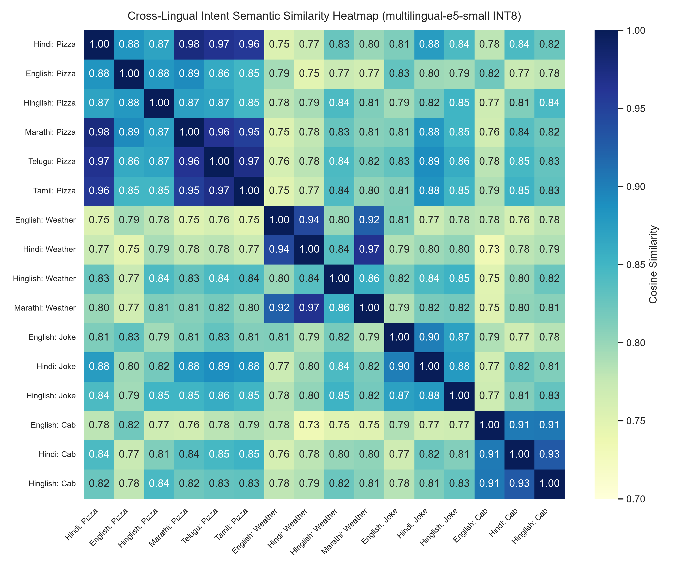

# rustem

A high-performance, multi-threaded CPU-only text embedding service and library written in Rust using ONNX Runtime (`ort`). Optimized for low-latency, real-time voice AI platforms (LiveKit) serving Indian languages: **Hindi, Marathi, Hinglish, Telugu, Tamil, and English**.

## Key Features
- **Optimized for CPU Inference:** Dynamic INT8 quantization tailored for AVX2 execution, achieving **~5.1 ms p50 latency** for batch=1 utterances.
- **Session Pooling:** Pool of $N$ independent ONNX sessions with configurable intra-op threads and non-spinning workers to prevent CPU contention.
- **Parallel Tokenization:** Hugging Face `tokenizers` parallelized with `rayon`.
- **Dynamic Batching:** Channel-based request/response batcher with length-sorted dynamic padding.
- **In-Memory LRU Cache:** Sub-microsecond response times for recurrent voice intents ("yes", "cancel", "repeat").
- **Quality Verified:** Cosine fidelity of **`0.9967`** against FP32 reference with **0.00% drop in Recall@1** on cross-lingual intent retrieval.

---

## Benchmark Results (Intel Core i5-9300H CPU @ 2.40GHz, AVX2)

| Batch Size | p50 Latency (ms) | p95 Latency (ms) | p99 Latency (ms) | Throughput (texts/sec) | Memory RSS |
| :--- | :--- | :--- | :--- | :--- |
| **1 (Voice Utterance)** | **5.15 ms** | **7.31 ms** | **7.87 ms** | **181.7** | **433 MB** |
| **8** | 29.02 ms | 36.42 ms | 39.29 ms | 267.8 | 438 MB |
| **16** | 51.82 ms | 64.18 ms | 68.39 ms | 302.2 | 443 MB |
| **64** | 216.94 ms | 255.66 ms | 274.48 ms | 289.6 | 471 MB |

---

## Quality Evaluation

- **Fidelity vs FP32 Reference:** Mean Cosine = **`0.99667`** (Min: `0.99187`).
- **Multilingual Intent Retrieval (202 utterances across 6 language forms):**
  - **Recall@1:** **91.09%** on both FP32 and INT8 (0.00% delta).
  - **Recall@5:** 98.51% (FP32) vs 98.02% (INT8).
  - **MRR:** 0.9432 (FP32) vs 0.9425 (INT8).

### Multilingual Similarity Heatmap


---

## Quickstart

### 1. Build the Rust Project
```bash
cargo build --release
```

### 2. Download or Export ONNX Models
```bash
python scripts/export_onnx.py
```
Or download directly:
```bash
curl -L -o models/model_quantized.onnx https://huggingface.co/Xenova/multilingual-e5-small/resolve/main/onnx/model_quantized.onnx
curl -L -o models/tokenizer.json https://huggingface.co/Xenova/multilingual-e5-small/resolve/main/tokenizer.json
```

### 3. Run Quality Evaluation & Benchmarks
```bash
python scripts/eval.py
python scripts/benchmark_python.py --iterations 1000
```

### 4. Run Rust Embedder Service
```bash
# Start HTTP service
./target/release/embed-service serve --port 8080

# Benchmark CLI
./target/release/embed-service bench --batch-sizes 1,8,16,64 --iterations 1000
```
