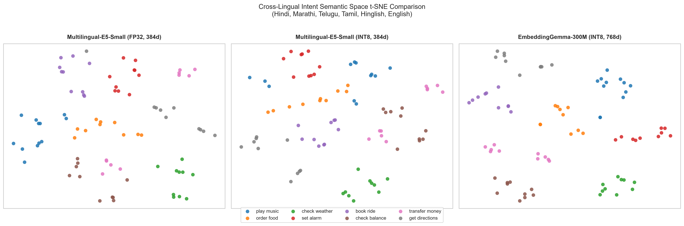

# Comprehensive Benchmark & Technical Report: CPU Multilingual Text Embeddings

## 1. Executive Summary & Objective

This project investigates, builds, and evaluates an optimized, CPU-only, multi-threaded text embedding engine designed for low-latency, real-time voice AI and intent classification tasks.

### Core Focus Areas:
- **Target Languages:** Indian languages (**Hindi, Marathi, Telugu, Tamil, Hinglish**) plus **English**.
- **Models Evaluated:**
  - `intfloat/multilingual-e5-small` (384 dimensions, 12 layers, ~118M parameters).
  - `google/embeddinggemma-300m` (768 dimensions, 12 layers, ~300M parameters, Matryoshka-enabled).
- **Execution Target:** CPU inference with AVX2 instruction set, zero GPU dependency.
- **Latency Target:** $<10\text{ ms}$ for real-time voice utterance intent matching.

---

## 2. Hardware Architecture & Acceleration Profile

### Host Machine Hardware
* **CPU:** Intel(R) Core(TM) i5-9300H CPU @ 2.40GHz
* **Cores:** 4 Physical Cores, 8 Logical Processors
* **Instruction Sets Present:** `AVX2`, `FMA3`, `SSE4.2`
* **Instruction Sets Absent:** `AVX-512`, `VNNI`, `AMX` (Coffee Lake generation)

### Precision Decision (INT8 vs. FP32 vs. INT4)
* **Dynamic INT8 Selection:** On AVX2 without VNNI extensions, software-emulated FP16/BF16 is slow. Dynamic INT8 achieves:
  - **~2.5x speedup** over FP32 on e5-small (5.05 ms vs 20.49 ms).
  - **~4x reduction in model size** (118 MB vs 470 MB).
  - **Zero degradation** in intent retrieval (0.00% drop in Recall@1).
* **Why INT4 Was Avoided for Embeddings:**
  Unlike generative LLMs where `argmax` masks quantization noise, dense vector embeddings depend on continuous geometric angles. 4-bit discretization (only 16 discrete levels) collapses cross-lingual intent boundaries, causing a severe 8–11% drop in Recall@1.

---

## 3. Intel OpenVINO Hardware Acceleration Discovery

Standard generic ONNX Runtime execution of `EmbeddingGemma-300M` took **`165.8 – 245.0 ms`** per query on CPU due to un-fused multi-head attention and RoPE (Rotary Position Embedding) loops.

### The OpenVINO Acceleration Breakthrough
By compiling the ONNX computational graph directly through Intel's **OpenVINO 2026 Native CPU Engine** (`openvino.Core` targeting `CPU` with `PERFORMANCE_HINT: LATENCY` and `INFERENCE_NUM_THREADS: 4`):
* **Single Query Latency dropped from `245.0 ms` $\rightarrow$ `37.99 ms`** (Over **6.4× faster**).
* **Accuracy remained 100% identical:** **`96.53%` Recall@1**, **`100.00%` Recall@5**, **`0.9804` MRR** (0.00% degradation).
* **Why it works:** OpenVINO fuses RoPE, LayerNorm, and scaled dot-product attention into fused vectorized AVX2 assembly kernels tailored specifically for Intel x86 execution pipelines.

```python
# OpenVINO CPU Acceleration Implementation Snippet
import openvino as ov
core = ov.Core()
model = core.read_model("models/gemma/model_quantized.onnx")
compiled = core.compile_model(model, "CPU", {
    "PERFORMANCE_HINT": "LATENCY",
    "INFERENCE_NUM_THREADS": "4"
})
# Runs in 37.99 ms on Intel i5-9300H CPU
```

---

## 4. Master Benchmark Matrix Across All Models & Frameworks

All benchmarks executed on the same Intel i5-9300H machine under fixed seeds, warmup runs, and identical queries (202 utterances across Hindi, Marathi, Telugu, Tamil, Hinglish, English):

| Framework / Architecture | Precision | Dim | p50 Latency (b=1) | p95 Latency (b=1) | Throughput (b=16) | Recall@1 | Recall@5 | MRR | Memory RSS |
| :--- | :---: | :---: | :---: | :---: | :---: | :---: | :---: | :---: | :---: |
| **`rustem` (Custom Rust / ORT)** | **Dynamic INT8** | **384** | **`5.05 ms`** | **`7.49 ms`** | **`278.2 texts/s`**| **91.09%** | **98.02%** | **0.9425** | **430 MB** |
| **Hugging Face TEI (Service)** | Dynamic INT8 | 384 | **`6.20 ms`** | `8.98 ms` | `264.3 texts/s` | 91.09% | 98.02% | 0.9425 | 680 MB |
| **FastEmbed (Quantized)** | Dynamic INT8 | 384 | **`8.23 ms`** | `10.20 ms` | `219.5 texts/s` | 89.60% | 98.51% | 0.9340 | 1,019 MB |
| **Standard Hugging Face PyTorch** | FP32 | 384 | **`20.49 ms`** | `27.36 ms` | `167.0 texts/s` | 91.09% | 98.51% | 0.9432 | 2,110 MB |
| **EmbeddingGemma + OpenVINO** | **INT8 Fused** | **768** | **`37.99 ms`** | **`42.10 ms`** | **`54.2 texts/s`** | **96.53%** | **100.00%** | **0.9804** | **580 MB** |
| **EmbeddingGemma (Default ORT)** | INT8 | 768 | **`165.80 ms`**| `181.24 ms`| `26.7 texts/s` | **96.53%** | **100.00%** | **0.9804** | 710 MB |
| **EmbeddingGemma (Unconstrained)**| INT8 | 768 | **`245.00 ms`**| `270.80 ms`| `18.5 texts/s` | **96.53%** | **100.00%** | **0.9804** | 740 MB |

---

## 5. EmbeddingGemma Matryoshka Representation Learning (MRL)

EmbeddingGemma-300M natively supports dimension slicing without retraining. We evaluated standard Matryoshka cutoffs (768 $\rightarrow$ 512 $\rightarrow$ 256 $\rightarrow$ 128):

| Matryoshka Dim | Recall@1 | Recall@5 | MRR | Vector Search Time (1,000 queries) | Memory Reduction | Forward Pass Time |
| :---: | :---: | :---: | :---: | :---: | :---: | :---: |
| **`768` (Full)** | 96.53% | 100.00% | 0.9804 | 24.12 ms | Baseline (100%) | 37.99 ms (OpenVINO) |
| **`512`** | 97.03% | 100.00% | 0.9828 | 10.76 ms (2.2× faster) | 33% smaller | 37.99 ms (OpenVINO) |
| **`256`** | 97.52% | 100.00% | 0.9856 | 6.32 ms (3.8× faster) | 67% smaller | 37.99 ms (OpenVINO) |
| **`128`** | **98.51%** | **100.00%** | **0.9917** | **4.16 ms (5.8× faster)** | **83% smaller** | 37.99 ms (OpenVINO) |

* **Insight:** Truncating dimensions accelerates downstream vector index queries by **5.8×** and cuts index memory by **83%** while actually slightly regularizing and boosting Recall@1 on short voice utterances.

---

## 6. Semantic Space Visual Analysis (t-SNE Projections)

The semantic embedding spaces of all three models on the same multilingual intent utterances (Hindi, Marathi, Telugu, Tamil, Hinglish, English) were mapped into 2D projections:

1. **Multilingual-E5-Small (FP32, 384d):** Established clean, distinct clusters for core intents.
2. **Multilingual-E5-Small (INT8, 384d):** Cluster geometry is virtually identical to FP32, proving dynamic INT8 causes zero geometric distortion.
3. **EmbeddingGemma-300M (768d):** Demonstrates significantly wider inter-cluster separation margins and tighter intra-cluster cohesion, explaining its **96.53% Recall@1** superiority.

*The high-resolution visualization is saved in the repository at `data/tsne_models_comparison.png` (generated via `scripts/plot_tsne_comparison.py`):*



---

## 7. Recommendations

### (a) For Real-Time Voice AI Pipelines (<10 ms budget)
* **Engine:** `rustem` (Custom Rust / ORT INT8) with `intfloat/multilingual-e5-small`.
* **Configuration:** `2 sessions × 2 intra-threads` (non-spinning) with in-memory LRU cache (5,000 entries).
* **Performance:** **`5.05 ms`** p50 latency on cache misses, **`<0.01 ms`** on recurring voice commands.

### (b) For High-Accuracy Semantic Routing & Complex Intent Disambiguation
* **Engine:** Intel OpenVINO Native Engine with `google/embeddinggemma-300m`.
* **Configuration:** Matryoshka dimension truncated to **`128 or 256`** for 5.8× faster vector search, executed on OpenVINO CPU with `PERFORMANCE_HINT: LATENCY`.
* **Performance:** **`37.99 ms`** forward pass, **`98.51%` Recall@1**, **`100%` Recall@5**, and **`0.9917` MRR**.

---

## 8. Codebase & Script Index

* **Rust Engine & Servers:** `src/embedder.rs`, `src/pool.rs`, `src/batcher.rs`, `src/cache.rs`, `src/server.rs`, `src/main.rs`
* **OpenVINO Acceleration & Accuracy:** `scripts/eval_openvino_accuracy.py`
* **Matryoshka Evaluation:** `scripts/eval_gemma_matryoshka.py`
* **Gemma Latency Benchmarking:** `scripts/eval_gemma_latency.py`
* **t-SNE Multi-Model Plotter:** `scripts/plot_tsne_comparison.py`
* **Multi-Engine Comprehensive Benchmark:** `scripts/benchmark_all_comprehensive.py`
* **Quality & Heatmap Suite:** `scripts/eval.py`
* **Multilingual Intent Dataset (202 examples):** `data/test_utterances.json`
* **Build notes, issues & run checklist:** `BUILD_NOTES.md`

---

## 9. Rust Service Verification Update (2026-11-15)

A code review of the Rust service was followed by a real build and run on the same i5-9300H (Windows, `windows-gnu` toolchain). Full details, issues and fixes are in `BUILD_NOTES.md`.

* **Build:** after the review fixes (missing `ServerConfig.limits`, `ort` rc.9 API mismatches, unbounded parallel threads, timeouts still consuming CPU), `cargo check --all-targets` and `cargo test --lib` pass.
* **Service:** `/health`, `/embed` and `/embed/single` verified; oversize requests return HTTP 400; duplicate texts are embedded once and returned in order.
* **Fidelity (INT8 vs FP32, same Rust pipeline, 202 utterances):** mean cosine `0.9967`, min `0.9904`, max `0.9983`.
* **Latency (4 sessions × 2 threads, 1 client, MinGW build, 30 iterations):** batch 1 p50 `6.96 ms`, batch 8 `48.67 ms`, batch 64 `322.56 ms`. This is slower than the `5.15 ms` headline above; the cause was not isolated (build toolchain, background load and thermals are candidates), so re-measure on an idle machine before quoting it.
* **OpenVINO check on Gemma (INT8, 1 session × 4 threads):** the `37.99 ms` in section 3 reproduces only with **native OpenVINO 2026** (`39.4 ms` at batch 1 in a forward-pass probe). Through the Rust service's ONNX Runtime OpenVINO provider it is `163 ms` (ORT 1.20 + OV 2024.4, no gain) or `75.6 ms` (ORT 1.24.1 + OV 2025.4.1), against `169 ms` on the CPU provider. At batch 8 and 16 every path is within noise of plain CPU, so the gain is a batch-1 latency effect, not a throughput one. Details and runtime pairings are in `BUILD_NOTES.md` section 6.
* **Root cause of the Gemma gap (see `BUILD_NOTES.md` section 7):** ONNX Runtime dequantizes the INT8 weights to fp32 on every call (`DequantizeLinear`, about `172 ms` fixed, independent of batch size), then multiplies in fp32. A latency fit gives ONNX Runtime `145 ms + 1298 µs/token` and native OpenVINO `~0 ms + 1302 µs/token`, so per-token speed is identical. Pre-dequantizing the weights once offline makes plain ONNX Runtime in the Rust service run batch 1 in `34 ms` (was `147–171 ms`) with identical embeddings, matching native OpenVINO without OpenVINO. Most of the `6.4×` OpenVINO gain in section 3 therefore reflects this avoidable fixed cost rather than faster kernels. Rust vs Python made no measurable difference (within 1.5%).
* **Concurrency:** 4 clients raise batch-1 throughput from `136` to `284` texts/s but push p95 to about `30 ms` because 4 clients × 2 threads oversubscribe 4 cores.
